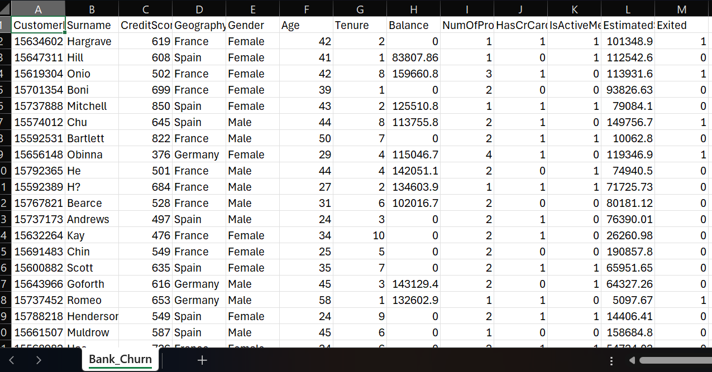

# Bank_Churn_Customer_Analysis.

## Project Overview.

The **Bank Churn Customer Analysis** project examines customer churn patterns using a dataset of 10,000 bank customers. The analysis focuses on identifying customer segments with higher churn rates and examining how geography, gender, age, credit score, tenure, account balance, number of products, and active membership relate to customer churn.

The project follows a structured data analytics workflow:

**Excel → SQL Server Management Studio (SSMS) → Power BI**

Excel was used for initial data preparation and adjustments. SQL Server Management Studio (SSMS) was used to validate the dataset through checks for duplicate records, Customer ID uniqueness, NULL values, categorical and binary values, and unusual numerical values. Within Power BI, Power Query was used for data transformation and manipulation, including creating categorical groups for analysis. DAX was used to develop measures, while Power BI visualizations were used to analyze customer churn patterns and build an interactive dashboard.

The dataset contains **10,000 unique customers**, of which **2,037 have churned**, representing an overall churn rate of **20.37%**.

The objective is to identify customer segments associated with higher churn rates and present data-driven findings that can inform customer retention strategies.

##  Business Problem.

Customer churn refers to the loss of customers who discontinue their relationship with a business or stop using its products and services. In the banking sector, this occurs when customers leave a bank and end their banking relationship. Customer churn is a concern for banks because the loss of existing customers can affect customer retention, revenue and long-term business growth.

Understanding customer churn patterns is therefore important for identifying customer segments with higher rates of customer loss and determining where retention efforts may require greater attention.

This project examines the bank's customer data to identify patterns in churn across different customer characteristics and provide insights that can inform customer retention strategies.

The analysis seeks to answer the following business questions:

- What is the overall customer churn rate?
- Which geographical regions have higher churn rates?
- How do churn rates differ by gender and age group?
- How does the number of products held relate to customer churn?
- How does active membership relate to customer churn?
- How does credit score, account balance and customer tenure relate to churn?

##  Data Source and Dataset.

### Data Source.

The dataset used for this project was obtained from the **Maven Analytics Data Playground**, under the *Bank Customer Churn* dataset. It contains customer account information from a European bank and is meant for data analysis and learning purposes.

Maven Analytics identifies Kaggle as the dataset's original source and lists the licence as Public Domain.

**Dataset source:** [Maven Analytics – Bank Customer Churn](https://mavenanalytics.io/data-playground/bank-customer-churn)

### Dataset Description.

The dataset contains **10,000 customer records and 13 columns**, with each row representing an individual bank customer. It includes demographic, financial and account-related information, alongside a field indicating whether the customer left the bank.

The `Exited` column serves as the target variable for the churn analysis:
- `1` = Customer exited the bank.
- `0` = Customer remained with the bank.

### Original Dataset

The screenshot below shows the original dataset before data preparation and validation.

