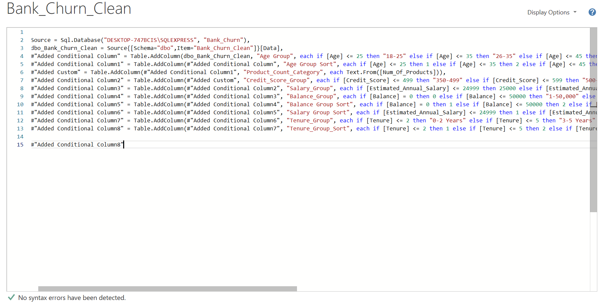
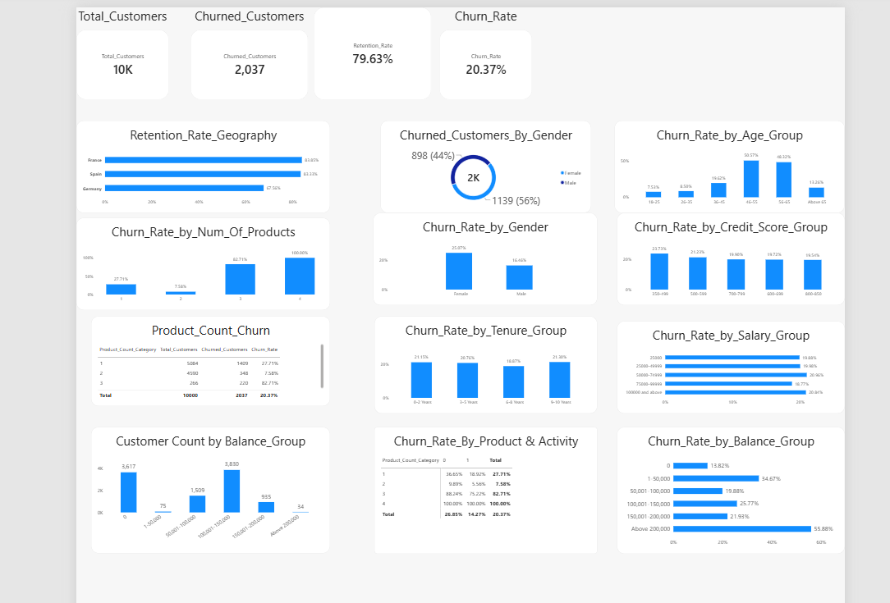
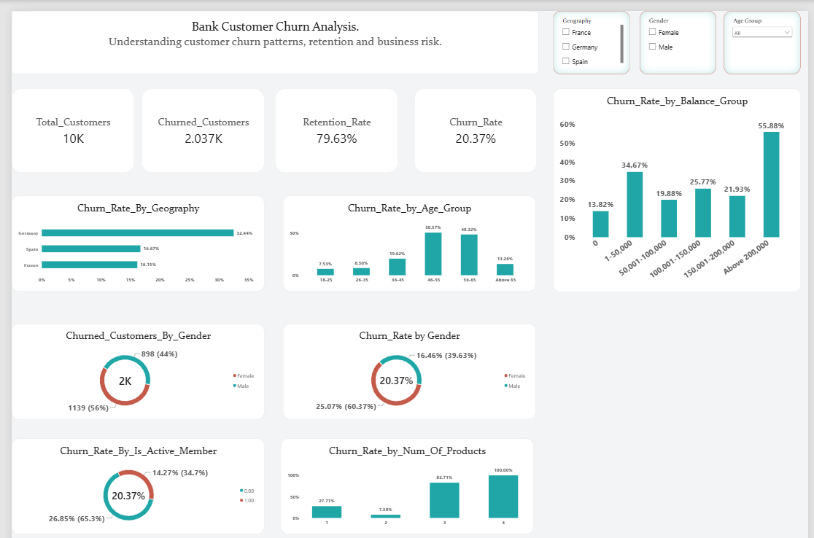

# Bank_Churn_Customer_Analysis.


## Project Overview.

The **Bank Churn Customer Analysis** project examines customer churn patterns using a dataset of 10,000 bank customers. The analysis focuses on identifying customer segments with higher churn rates and examining how geography, gender, age, credit score, tenure, account balance, number of products, and active membership relate to customer churn.

The project follows a structured data analytics workflow:

**Excel → SQL Server Management Studio (SSMS) → Power BI**

Excel was used for initial data preparation and adjustments. SQL Server Management Studio (SSMS) was used to validate the dataset through checks for duplicate records, Customer ID uniqueness, NULL values, categorical and binary values, and unusual numerical values. Within Power BI, Power Query was used for data transformation and manipulation, including creating categorical groups for analysis. DAX was used to develop measures, while Power BI visualizations were used to analyze customer churn patterns and build an interactive dashboard.

The dataset contains **10,000 unique customers**, of which **2,037 have churned**, representing an overall churn rate of **20.37%**.

The objective is to identify customer segments associated with higher churn rates and present data-driven findings that can inform customer retention strategies.

##  Business Problem.

Customer churn refers to the loss of customers who discontinue their relationship with a business or stop using its products and services. In the banking sector, this occurs when customers leave a bank and end their banking relationship. Customer churn is a concern for banks because the loss of existing customers can affect customer retention, revenue and long-term business growth.

Understanding customer churn patterns is therefore important for identifying customer segments with higher rates of customer loss and determining where retention efforts may require greater attention.

This project examines the bank's customer data to identify patterns in churn across different customer characteristics and provide insights that can inform customer retention strategies.

The analysis seeks to answer the following business questions:

- What is the overall customer churn rate?
- Which geographical regions have higher churn rates?
- How do churn rates differ by gender and age group?
- How does the number of products held relate to customer churn?
- How does active membership relate to customer churn?
- How does credit score, account balance and customer tenure relate to churn?

##  Data Source and Dataset.

### Data Source.

The dataset used for this project was obtained from the **Maven Analytics Data Playground**, under the *Bank Customer Churn* dataset. It contains customer account information from a European bank and is meant for data analysis and learning purposes.

Maven Analytics identifies Kaggle as the dataset's original source and lists the licence as Public Domain.

**Dataset source:** [Maven Analytics – Bank Customer Churn](https://mavenanalytics.io/data-playground/bank-customer-churn)

### Dataset Description.

The dataset contains **10,000 customer records and 13 columns**, with each row representing an individual bank customer. It includes demographic, financial and account-related information, alongside a field indicating whether the customer left the bank.

The `Exited` column serves as the target variable for the churn analysis:
- `1` = Customer exited the bank.
- `0` = Customer remained with the bank.

### Original Dataset.

The screenshot below shows the original dataset before data preparation and validation.


##  Tools Used.

The following tools were used throughout the project:

- **Microsoft Excel:** Used for initial data preparation and adjustments.
- **SQL Server Management Studio (SSMS):** Used to validate the dataset through duplicate checks, NULL checks, Customer_ID verification and other data-quality checks.
- **Power BI:** Used for data analysis, DAX calculations, visualisations and interactive dashboard development.
- **Power Query:** Used within Power BI for data transformation and manipulation, including the creation of categorical groups and sorting columns.
- **GitHub:** Used to document and present the project as part of a data analytics portfolio.

##  Data Preparation and Validation.

Data preparation and validation were carried out using Microsoft Excel, SQL Server Management Studio (SSMS), and Power Query within Power BI. Each tool served a specific purpose in preparing the dataset for analysis.

###  Excel Data Preparation.

Microsoft Excel was used for initial data preparation and adjustments before importing the dataset into SQL Server.

The prepared dataset is shown below:


###  SQL Server Data Validation.

SQL Server Management Studio (SSMS) was used to validate the imported dataset and assess its data quality.

The validation checks included:

- Checking for duplicate records.

```sql
SELECT DISTINCT *
INTO dbo.Bank_Churn_Clean
FROM dbo.Bank_Churn_Data$;
```

This query created the cleaned table, dbo.Bank_Churn_Clean, by removing duplicate records from the original imported table, reducing the dataset from 21,881 rows to 10,000 unique customer records.


- Verifying the uniqueness of Customer_ID values.

```sql
SELECT
    COUNT(*) AS Total_Records,
    COUNT(DISTINCT Customer_ID) AS Unique_Customers
FROM dbo.Bank_Churn_Clean;
```

Results:
- Total Records: 10,000
- Unique Customers: 10,000

This confirmed that every customer ID in the cleaned table was unique.


- Checking for NULL values across the dataset.

```sql
SELECT
    SUM(CASE WHEN Customer_ID IS NULL THEN 1 ELSE 0 END) AS Customer_ID_NULLs,
    SUM(CASE WHEN Surname IS NULL THEN 1 ELSE 0 END) AS Surname_NULLs,
    SUM(CASE WHEN Credit_Score IS NULL THEN 1 ELSE 0 END) AS Credit_Score_NULLs,
    SUM(CASE WHEN Geography IS NULL THEN 1 ELSE 0 END) AS Geography_NULLs,
    SUM(CASE WHEN Gender IS NULL THEN 1 ELSE 0 END) AS Gender_NULLs,
    SUM(CASE WHEN Age IS NULL THEN 1 ELSE 0 END) AS Age_NULLs,
    SUM(CASE WHEN Tenure IS NULL THEN 1 ELSE 0 END) AS Tenure_NULLs,
    SUM(CASE WHEN Balance IS NULL THEN 1 ELSE 0 END) AS Balance_NULLs,
    SUM(CASE WHEN Num_Of_Products IS NULL THEN 1 ELSE 0 END) AS Products_NULLs,
    SUM(CASE WHEN Has_Credit_Card IS NULL THEN 1 ELSE 0 END) AS Credit_Card_NULLs,
    SUM(CASE WHEN Is_Active_Member IS NULL THEN 1 ELSE 0 END) AS Active_Member_NULLs,
    SUM(CASE WHEN Estimated_Annual_Salary IS NULL THEN 1 ELSE 0 END) AS Salary_NULLs,
    SUM(CASE WHEN Exited IS NULL THEN 1 ELSE 0 END) AS Exited_NULLs
FROM dbo.Bank_Churn_Clean;
```

Result: All 13 columns returned 0 NULL values.


- Examining categorical and binary values for consistency.

```sql
SELECT
    Geography,
    COUNT(*) AS Customer_Count
FROM dbo.Bank_Churn_Clean
GROUP BY Geography
ORDER BY Geography;
```

```sql
SELECT
    Gender,
    COUNT(*) AS Customer_Count
FROM dbo.Bank_Churn_Clean
GROUP BY Gender
ORDER BY Gender;
```

```sql
SELECT
SUM(CASE WHEN Has_Credit_Card NOT IN (0, 1) THEN 1 ELSE 0 END) AS Invalid_Credit_Card_Values,
    SUM(CASE WHEN Is_Active_Member NOT IN (0, 1) THEN 1 ELSE 0 END) AS Invalid_Active_Member_Values,
    SUM(CASE WHEN Exited NOT IN (0, 1) THEN 1 ELSE 0 END) AS Invalid_Exited_Values
FROM dbo.Bank_Churn_Clean;
```

Result: All three columns returned 0 invalid values.


- Reviewing unusual numerical values, including salary values below $1,000 and customers with zero account balances.

```sql
SELECT
    COUNT(*) AS Salary_Values_Below_1000
FROM dbo.Bank_Churn_Clean
WHERE Estimated_Annual_Salary < 1000;
```

Result: 59 records.

```sql
SELECT
    COUNT(*) AS Customers_With_Zero_Balance
FROM dbo.Bank_Churn_Clean
WHERE Balance = 0;
```

Result: 3,617 records.

Both groups were reviewed and retained because I found no evidence that the values were incorrect.


- Identifying surname records containing question marks.

```sql
SELECT
    COUNT(*) AS Surnames_With_Question_Marks
FROM dbo.Bank_Churn_Clean
WHERE Surname LIKE '%?%';
```

Result: 92 records across seven surname patterns.


**Findings:** The query identified 92 customer records across seven surname patterns: H? (19), Hs? (15), L? (14), Y? (13), Y?an (13), K? (11), and Hs?eh (7).

The records were retained because the original surname characters could not be reliably recovered. Deleting them would have reduced the dataset from 10,000 to 9,908 records and resulted in the loss of otherwise usable customer information. Retaining them helped preserve data completeness and avoid unnecessary data loss.

The validation process helped assess the dataset's consistency and identify unusual values requiring review. Records were retained where there was insufficient evidence to classify the values as errors.

###  Power Query Data Transformation.

Power Query was used within Power BI to transform and manipulate the data for analysis.

The transformations included creating categorical groups for:

- Age Group
- Credit Score Group
- Salary Group
- Tenure Group
- Balance Group
- Product Count Category

Additional sorting columns were created to maintain the correct order of these grouped categories in the Power BI visualisations.

Find the Power query advanced editor below:




##  Data Analysis and DAX Measures.

DAX (Data Analysis Expressions) was used in Power BI to create measures for calculating key customer churn and retention metrics.

The following measures were created:

###  Total Customers

**Purpose:** Counts the total number of customer records in the cleaned dataset.

```dax
Total Customers = COUNTROWS(Bank_Churn_Clean)
```

**Result:** 10,000 customers.

###  Churned Customers

**Purpose:** Counts customers who exited the bank, where `Exited = 1`.

```dax
Churned Customers =
CALCULATE(
    COUNTROWS(Bank_Churn_Clean),
    Bank_Churn_Clean[Exited] = 1
)
```

**Result:** 2,037 churned customers.

###  Churn Rate

**Purpose:** Calculates the percentage of customers who exited the bank relative to the total customer base.

```dax
Churn Rate =
DIVIDE(
    [Churned Customers],
    [Total Customers],
    0
)
```

**Result:** 20.37%.

###  Retention Rate

**Purpose:** Calculates the percentage of customers who remained with the bank.

```dax
Retention Rate =
1 - [Churn Rate]
```

**Result:** 79.63%.

###  Customer Churn Analysis

The measures were used to examine customer churn patterns across the following dimensions:

- Geography
- Gender
- Age Group
- Number of Products
- Active Membership
- Credit Score Group
- Salary Group
- Tenure Group
- Balance Group

The analysis focused on comparing churn rates across customer segments to identify patterns and areas that may require attention from the bank's management team.


##  Power BI Dashboard and Visualizations.

The **Bank Customer Churn Analysis** Power BI report consists of two pages, each serving a different purpose in presenting the analysis.

The first page, **Bank Churn Detailed Analysis**, serves as a supporting analysis page. It contains the individual visualizations used to examine customer churn patterns across different customer characteristics and account-related variables. It does not include slicers and is primarily used to support the detailed examination of the results.

The second page, **Bank Churn Main Dashboard**, is the main interactive dashboard. It brings together the key performance indicators (KPIs) and selected visualizations in a consolidated layout. It also includes slicers for Geography, Gender and Age Group, allowing users to filter the dashboard and examine churn patterns across different customer segments.

###  Bank Churn Detailed Analysis Page

The detailed analysis page contains the supporting visualizations used to examine customer churn across the selected variables.



Bank Churn Main Dashboard

The main dashboard presents the key findings through four KPI cards, seven visualizations and three interactive slicers. It provides a consolidated view of customer churn and allows users to explore the results using the available filters.




##  Key Findings and Business Insights

This section presents the main findings from the Bank Customer Churn Analysis and explains their potential business implications. The findings are based on comparisons of churn rates across customer demographics, geographical regions and account-related characteristics.

###  Key Findings

The analysis produced the following findings:

**1. Overall Customer Churn**

Out of 10,000 customers, 2,037 had exited the bank, representing a churn rate of **20.37%**. The remaining 7,963 customers represented a retention rate of **79.63%**.

**2. Customer Churn by Geography**

Germany recorded the highest churn rate at **32.44%**, compared with Spain at **16.67%** and France at **16.15%**. This indicates a substantial difference in customer churn across the three geographical markets.

**3. Customer Churn by Gender**

Female customers recorded a higher churn rate of **25.07%**, compared with **16.46%** among male customers. Female customers also accounted for 56% of all churned customers, while male customers accounted for 44%.

**4. Customer Churn by Age Group**

Customers aged **46–55** recorded the highest churn rate at **50.57%**, followed by customers aged **56–65** at **46.32%**. The 26–35 age group recorded the lowest churn rate at **8.50%**.

**5. Customer Churn by Number of Products**

Customers holding three products recorded a churn rate of **82.71%**, while those holding four products recorded **100%**. In comparison, customers holding one product had a churn rate of **27.71%**, and those holding two products recorded **7.58%**.

However, the three-product and four-product groups contained only 266 and 60 customers respectively. Their high churn rates should therefore be interpreted with caution.

**6. Customer Churn by Account Balance**

Customers with balances between **$100,001 and $150,000** recorded a churn rate of **25.77%**, representing the largest customer group with 3,830 records.

The highest churn rate occurred among customers with balances above $200,000 at **55.88%**, but this group contained only 34 customers. Customers with zero balances recorded a lower churn rate of **13.82%**.

**7. Customer Churn by Credit Score**

Churn rates across credit score groups ranged from **19.54% to 23.73%**. The 350–499 credit score group recorded the highest rate, while the 800–850 group recorded the lowest. The relatively small difference suggests that credit score had a weaker relationship with churn than some of the other customer characteristics examined.

**8. Customer Churn by Salary and Tenure**

Salary-group churn rates ranged from **18.77% to 20.96%**, while tenure-group churn rates ranged from **18.87% to 21.30%**. These relatively narrow ranges show no clear pattern of increasing or decreasing churn across salary or tenure groups.

###  Business Insights

The findings highlight several areas that may require further attention from the bank's customer retention team.

- **Geographical differences:** Germany's higher churn rate suggests that the bank may need to examine customer experience, service delivery and retention practices in that market.
- **Gender differences:** The higher churn rate among female customers suggests an opportunity to investigate differences in customer needs, engagement and satisfaction.
- **Age-related churn:** The higher churn rates among customers aged 46–65 indicate that this age segment may require closer examination to understand the factors associated with customer exits.
- **Product ownership:** The high churn rates among customers holding three or four products warrant further investigation. The bank should examine product combinations, usage patterns and customer experiences within these smaller groups.
- **Account balance:** The higher churn rate among customers with balances between $100,001 and $150,000 deserves attention because this is a large customer segment. The result for customers above $200,000 should be treated cautiously due to the small sample size.
- **Credit score, salary and tenure:** These variables showed relatively small differences in churn rates across their respective groups. They may be less useful as standalone indicators of churn in this dataset.

###  Recommendations

Based on the findings, the following actions could be considered by the bank:

1. **Review customer retention in Germany:** Investigate the reasons behind the higher churn rate and assess whether local customer experience or service issues contribute to the pattern.

2. **Strengthen customer engagement:** Examine the needs and experiences of female customers and customers aged 46–65 to identify possible improvements in customer communication and retention programs.

3. **Investigate multi-product customers:** Review the products held by customers with three or four products, including product combinations, usage and account activity, before making changes to product offerings.

4. **Prioritizes large customer segments:** Examine the needs and churn patterns of customers with balances between $100,001 and $150,000, given the size of this group and its 25.77% churn rate.

5. **Monitor smaller customer segments carefully:** Conduct further investigation into customers with balances above $200,000 and those holding three or four products before making broad retention decisions based on their high churn rates.

6. **Use multiple customer indicators:** Avoid relying on credit score, salary or tenure alone when identifying customers who may be at risk of leaving. Consider these variables alongside other customer characteristics and account activity.

These recommendations are based on observed associations in the dataset. Further investigation would be required to establish the reasons behind customer churn and assess the effectiveness of any proposed retention measures.


